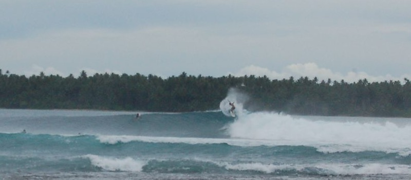



<a href="{{ base_path }}/files/CV.pdf" class="btn btn--inverse" download><i class="fas fa-download"></i> Download CV (PDF)</a>

  

    <button class="cv-accordion__toggle-all" data-action="expand">Expand all</button>
  

  <!-- ═══ RESEARCH ═══ -->
  

    

      
<i class="fas fa-flask"></i>

      

        <h2 class="cv-section__title">Research</h2>
        
2 publications

      

      

        <svg viewBox="0 0 24 24" fill="none" stroke="currentColor" stroke-width="2.5" stroke-linecap="round" stroke-linejoin="round"><polyline points="6 9 12 15 18 9"></polyline></svg>
      

    

    

    

      

        

          

            

            

              

                <h3 class="timeline-title">First-Stage Researcher</h3>
                Nov 2024 - Present
              

              <a href="https://www.inesc-id.pt" target="_blank">INESC-ID</a>
              <ul>
                <li>Designed a mechanism design protocol for accountable decision-making in DAOs; published results in 2 papers.</li>
                <li>Built a DAO smart contract system (Solidity, ERC-1155) for fractionalized real-world asset governance.</li>
                <li>Presented and discussed research with peers at INESC-ID's distributed systems group.</li>
              </ul>
            

          

        

        <h3 class="timeline-title">Interests</h3>
        <ul style="list-style: disc; padding-left: 1.5em; margin-bottom: 1.25em;">
          <li>Game Theory and Mechanism Design</li>
          <li>Information Aggregation</li>
          <li>Digital Assets</li>
          <li>Cryptography</li>
        </ul>

        <h3 class="timeline-title">Publications</h3>
        <ul style="list-style: disc; padding-left: 1.5em;">
          <li><strong>N. Braz</strong>, D. Poças, M. Correia, "<a href="https://drops.dagstuhl.de/entities/document/10.4230/LIPIcs.AFT.2026.17">Belief-Aware Pivotal Mechanism for DAO Committees</a>," in <em>8th Conference on Advances in Financial Technologies (AFT 2026)</em>, LIPIcs vol. 395, pp. 17:1--17:22, 2026.</li>
          <li><strong>N. Braz</strong>, "An Approach to Blockchain Voting for RWA Governance," in <em>2025 IEEE NCA</em>, pp. 312--313, IEEE, 2025. Blockchain-based voting using Threshold Homomorphic Encryption and Signatures of Knowledge.</li>
        </ul>
      

    

  

  <!-- ═══ INDUSTRY ═══ -->
  

    

      
<i class="fas fa-briefcase"></i>

      

        <h2 class="cv-section__title">Industry</h2>
        
1 position

      

      

        <svg viewBox="0 0 24 24" fill="none" stroke="currentColor" stroke-width="2.5" stroke-linecap="round" stroke-linejoin="round"><polyline points="6 9 12 15 18 9"></polyline></svg>
      

    

    

    

      

        

          

            

            

              

                <h3 class="timeline-title">Blockchain Engineer</h3>
                Jul 2023 - Nov 2024
              

              <a href="https://unlockit.io" target="_blank">Unlockit</a>
              <ul>
                <li>Designed and implemented two blockchain oracle architectures (on-chain and off-chain) for a property rental platform, comparing cost, latency, and trust trade-offs.</li>
                <li>Built with Daml and Java on the Canton Network.</li>
              </ul>
            

          

        

      

    

  

  <!-- ═══ TEACHING ═══ -->
  

    

      
<i class="fas fa-chalkboard-teacher"></i>

      

        <h2 class="cv-section__title">Teaching</h2>
        
2 courses

      

      

        <svg viewBox="0 0 24 24" fill="none" stroke="currentColor" stroke-width="2.5" stroke-linecap="round" stroke-linejoin="round"><polyline points="6 9 12 15 18 9"></polyline></svg>
      

    

    

    

      

        

          

            

            

              

                <h3 class="timeline-title"><a href="/teaching/2025-network-computer-security">Network and Computer Security</a></h3>
                Nov 2025 - Present
              

              Teaching Assistant &middot; Master's course &middot; <a href="https://tecnico.ulisboa.pt" target="_blank">Instituto Superior T&eacute;cnico</a>
              <ul>
                <li>Topics: secure code development, communication protocols, cryptography.</li>
                <li>Prepared and delivered practical lab sessions; mentored students and graded course projects.</li>
              </ul>
            

          

          

            

            

              

                <h3 class="timeline-title"><a href="/teaching/2026-distributed-systems">Distributed Systems</a></h3>
                Feb 2026 - Present
              

              Teaching Assistant &middot; Undergraduate course &middot; <a href="https://tecnico.ulisboa.pt" target="_blank">Instituto Superior T&eacute;cnico</a>
              <ul>
                <li>Topics: RPC, shared memory, coordination, fault tolerance, security.</li>
                <li>Developed course material including a cryptocurrency blockchain implementation using gRPC in Java.</li>
              </ul>
            

          

        

      

    

  

  <!-- ═══ EDUCATION ═══ -->
  

    

      
<i class="fas fa-graduation-cap"></i>

      

        <h2 class="cv-section__title">Education</h2>
        
4 entries

      

      

        <svg viewBox="0 0 24 24" fill="none" stroke="currentColor" stroke-width="2.5" stroke-linecap="round" stroke-linejoin="round"><polyline points="6 9 12 15 18 9"></polyline></svg>
      

    

    

    

      

        

          

            

            

              

                <h3 class="timeline-title">Master's Degree in Computer Science and Engineering</h3>
                2022 - 2024
              

              <a href="https://tecnico.ulisboa.pt" target="_blank">Instituto Superior T&eacute;cnico, University of Lisbon</a>
              
Specializations in Cybersecurity and Algorithms. Additional coursework from the Mathematics Master's programme: Introduction to Learning Theory and Computability and Complexity (among others).

            

          

          

            

            

              

                <h3 class="timeline-title">Exchange Program</h3>
                Jul 2024
              

              <a href="https://english.bit.edu.cn" target="_blank">Beijing Institute of Technology</a>
              
Electronics Engineering &amp; Chinese Culture.

            

          

          

            

            

              

                <h3 class="timeline-title">Exchange Program</h3>
                2023
              

              <a href="https://www.itba.edu.ar" target="_blank">Instituto Tecnologico de Buenos Aires</a>
              
AI courses.

            

          

          

            

            

              

                <h3 class="timeline-title">Bachelor's Degree in Information Systems and Computer Engineering</h3>
                2019 - 2022
              

              <a href="https://tecnico.ulisboa.pt" target="_blank">Instituto Superior T&eacute;cnico, University of Lisbon</a>
              
International coursework: Artificial Intelligence (ITBA, Argentina), Electronics Engineering (BIT, Beijing).

            

          

        

      

    

  

  <!-- ═══ PROJECTS ═══ -->
  

    

      
<i class="fas fa-project-diagram"></i>

      

        <h2 class="cv-section__title">Projects</h2>
        
5 projects

      

      

        <svg viewBox="0 0 24 24" fill="none" stroke="currentColor" stroke-width="2.5" stroke-linecap="round" stroke-linejoin="round"><polyline points="6 9 12 15 18 9"></polyline></svg>
      

    

    

    

      

        

          

            

            

              <h3 class="timeline-title"><a href="https://github.com/unlockitio/concordia" target="_blank">Concordia -- Canton Allocation Primitives</a></h3>
              
An open-source Daml interface library for privacy-preserving, multi-party allocation and decision workflows on the Canton Network, with private majority vote, sealed-bid auction, and weighted governance reference implementations.

            

          

          

            

            

              <h3 class="timeline-title"><a href="https://github.com/Nunobrazz/cnwla" target="_blank">cnwla -- Canton Network Ledger API CLI</a></h3>
              
A CLI for Canton Network ledgers. Wraps the HTTP JSON Ledger API v2 with ergonomic commands.

            

          

          

            

            

              <h3 class="timeline-title"><a href="https://github.com/Nunobrazz/dmsim" target="_blank">DMsim -- Decision Making Simulator</a></h3>
              
A Python simulator for comparing Decision Markets and VCG auctions as collective decision-making mechanisms, powered by LLM-generated agents.

            

          

          

            

            

              <h3 class="timeline-title"><a href="https://github.com/Nunobrazz/rwa-governance" target="_blank">DAO for Fractionalized Real World Asset Governance</a></h3>
              
A simplified DAO designed for Real World Asset (RWA) governance, using the ERC-1155 standard.

            

          

          

            

            

              <h3 class="timeline-title"><a href="https://github.com/Nunobrazz/renting-platform" target="_blank">A Lease Management System in DAML</a></h3>
              
A rental platform proof-of-concept built with Daml, featuring automated rent payments, maintenance issue reporting, and dispute resolution via arbitrators.

            

          

        

      

    

  

  <!-- ═══ CERTIFICATIONS & AWARDS ═══ -->
  

    

      
<i class="fas fa-award"></i>

      

        <h2 class="cv-section__title">Certifications and Awards</h2>
        
3 items

      

      

        <svg viewBox="0 0 24 24" fill="none" stroke="currentColor" stroke-width="2.5" stroke-linecap="round" stroke-linejoin="round"><polyline points="6 9 12 15 18 9"></polyline></svg>
      

    

    

    

      

        

          

            

            

              <h3 class="timeline-title"><a href="/files/teachingSteamStudents.pdf">Teaching Stem Students Certificate</a></h3>
              <a href="https://tecnico.ulisboa.pt" target="_blank">Instituto Superior T&eacute;cnico</a>
            

          

          

            

            

              <h3 class="timeline-title"><a href="/files/meritAward.pdf">Academic Merit Award</a></h3>
              <a href="https://tecnico.ulisboa.pt" target="_blank">Instituto Superior T&eacute;cnico</a>
            

          

          

            

            

              <h3 class="timeline-title"><a href="https://collectors.poap.xyz/reservation/nuno.braz%40tecnico.ulisboa.pt/drop/178315">Tokenized RWA Bootcamp</a></h3>
            

          

        

      

    

  

  <!-- ═══ LANGUAGES ═══ -->
  

    

      
<i class="fas fa-language"></i>

      

        <h2 class="cv-section__title">Languages</h2>
        
4 languages

      

      

        <svg viewBox="0 0 24 24" fill="none" stroke="currentColor" stroke-width="2.5" stroke-linecap="round" stroke-linejoin="round"><polyline points="6 9 12 15 18 9"></polyline></svg>
      

    

    

    

      

        

          

            

            

              <h3 class="timeline-title">Portuguese</h3>
              
Native

            

          

          

            

            

              <h3 class="timeline-title">English</h3>
              
Advanced

            

          

          

            

            

              <h3 class="timeline-title">Spanish</h3>
              
Advanced

            

          

          

            

            

              <h3 class="timeline-title">French</h3>
              
Working proficiency

            

          

        

      

    

  

  <!-- ═══ EXTRAS ═══ -->
  

    

      
<i class="fas fa-heart"></i>

      

        <h2 class="cv-section__title">Other Stuff</h2>
        
2 entries

      

      

        <svg viewBox="0 0 24 24" fill="none" stroke="currentColor" stroke-width="2.5" stroke-linecap="round" stroke-linejoin="round"><polyline points="6 9 12 15 18 9"></polyline></svg>
      

    

    

    

      

        

          

            

            

              <h3 class="timeline-title">Sports</h3>
              
Federated Rugby Player and Surf Athlete, competed in national competitions.

              

                
                
                
              

            

          

          

            

            

              <h3 class="timeline-title">Volunteering</h3>
              Batu Kapal Conservation, North Sumatra
              
Wildlife research, orangutan mapping, and habitat restoration.

            

          

        

      

    

  

