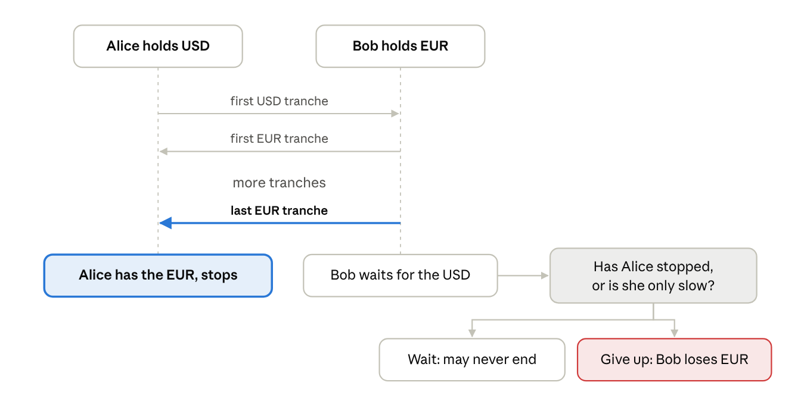

*Draft, November 2026. I'm still revising this.* **[Download the article (PDF)](/files/canton-fair-exchange.pdf)**

Canton's token standard lets assets be locked for a trade without a third party taking custody of them. Does it allow a fair exchange of assets kept by two different admins?

1. **When the terms are fixed in advance, Canton allows a fair exchange across two admins.**
2. **Under Token Standard V2, a third-party executor can settle one leg without the other.**
3. **Making Alice and Bob, or the two admins, executors makes the exchange fair, but at what cost?**

## 1. Alice and Bob want to trade

Alice holds US dollars (USD) and Bob holds euros (EUR). They agree a trade: $$X$$ USD for $$Y$$ EUR. The trade has two legs: (1) $$X$$ USD from Alice to Bob, (2) $$Y$$ EUR from Bob to Alice. Each leg is a transfer: the asset's admin debits the sender's account and credits the receiver's. Settling the trade means recording both transfers.

If Alice sends first, Bob can keep both the USD and the EUR, so Alice risks losing the whole $$X$$ USD she sent. An exchange is *fair* if it ends with Alice holding the EUR and Bob the USD, or with both keeping what they had.

<figure>
  
  <figcaption>Figure 1. The last-step problem in a trade.</figcaption>
</figure>

Settling in small tranches (Figure 1) reduces the amount at risk, but it doesn't remove the risk, and it adds significant communication and operational costs.

A cleverer protocol doesn't remove the problem. At some point one of them holds everything they need while the other still waits for a final message, and the first can simply stop replying. So no protocol run between Alice and Bob alone can guarantee a fair exchange (Pagnia and Gärtner, 1999).

The way out is a third party both sides trust. It receives the dollars and the euros, then delivers both or returns both, so neither side can receive without having sent.

## 2. Alice and Bob already trust the institutions that keep their assets. Isn't that enough?

Alice and Bob don't hold their assets directly. Their assets are balances in accounts kept by trusted entities (e.g. a bank for cash, a central securities depository for securities). I'll call them *admins*.[^admins] Alice and Bob already trust each admin to keep accurate balances and to record transfers as instructed. Isn't that trust enough?

**With one admin, it is.** Suppose Alice and Bob hold accounts at the same admin, say one bank. The admin settles both legs on its own ledger and records both in one step: the USD leg debits Alice's USD account and credits Bob's, and the EUR leg debits Bob's EUR account and credits Alice's.

That works because the admin *is* the trusted third party: it keeps both accounts, validates both transfers and records them together. And it adds no new trust. Alice and Bob already trusted the admin with their money; the exchange is fair only if the admin is honest, which they were relying on anyway.

**But wait.** Alice's dollars are held at the USD admin, a bank in New York, and Bob's euros at the EUR admin, a bank in Frankfurt. To settle, the USD admin must transfer her dollars to Bob's USD account, and the EUR admin must transfer his euros to Alice's EUR account. Each admin settles its own leg independently, so one leg settles first.

We've recreated the original problem, now between the two admins instead of between Alice and Bob. **When each admin settles on its own ledger, trust in each admin doesn't add up to trust in the exchange.** Neither admin controls both legs, so neither can play the role the single admin played.

Settling the two legs separately has failed before. In 1974 German regulators closed Herstatt Bank after it had received Deutsche Marks from its counterparties but before it paid them the dollars in New York, and those counterparties lost the dollar leg ([Norman, 2015](https://bankunderground.co.uk/2015/06/24/boe-archives-reveal-little-known-lesson-from-the-1974-failure-of-herstatt-bank/)). Herstatt was a counterparty, not an admin, but the loss came from the same gap: each leg settled in its own system, at its own time.

## 3. What is the minimum trust a fair exchange needs?

That raises the question of what exactly the third party must do. The usual picture is an intermediary that holds both items and delivers them, which does every job at once: it holds the assets, validates the transfers, records them and decides whether the exchange goes ahead. Take those jobs apart, and each one raises a question.

- **Must it hold the assets?**
- **Must it validate the transfers?**
- **Must it record the transfers?**
- **Must it decide whether to settle or abort?**

## 4. Who does each job in a Canton settlement

A settlement on [Canton](https://docs.canton.network) involves:

1. The two admins keep the accounts, as in Section 2: the USD admin keeps the USD accounts, and the EUR admin keeps the EUR accounts.
2. Each party has a *participant node* that validates transactions and sends back a confirmation, approve or reject.
3. A *synchronizer* orders encrypted parts of transactions, collects the nodes' confirmations and announces whether the transaction commits.
4. An *executor* builds the settlement transaction and submits it. It holds no assets, but it chooses which legs go into that transaction. Section 5 comes back to this.

The trade settles in three steps.

**Step 1: allocation (lock).** Alice creates an allocation of $$X$$ USD at the USD admin. The allocation states the conditions under which it can be settled: who may settle it (the executor), what it may transfer (here, $$X$$ USD to Bob) and, optionally, until when (a deadline; CIP-0112, Section 4.3.3). Bob creates one for $$Y$$ EUR at the EUR admin in the same way.[^v2alloc] An allocated asset can't be spent elsewhere. If the allocation is *committed*, it stays locked until it is settled, the executors cancel it, the admin expires it or the deadline passes, after which its owner can withdraw it. Otherwise its owner can withdraw it at any time (CIP-0112, Section 4.1.6).

**Step 2: validate and confirm (decide).** The executor submits one transaction that carries both legs. The synchronizer delivers each part to the nodes that must validate it, so (depending on the asset implementation) the USD admin sees only the USD leg and the EUR admin only the EUR leg (CIP-0112, Section 4.3.1). Each validates its part against its allocation (amount, receiver, deadline) and sends its confirmation.

The synchronizer commits the transaction only if every node that must confirm approves before a timeout. Otherwise it rejects the full transaction, so there is always one verdict for both legs.

**Step 3: apply (record).** On commit, each admin applies its own leg: the USD admin debits Alice and credits Bob, and the EUR admin debits Bob and credits Alice. On reject, nothing changes, and the allocations stay until the trade settles or their owners withdraw them.

Three properties follow from this split. No component ever holds both assets. The synchronizer sees only encrypted parts and metadata. And a faulty synchronizer can delay the trade, after which the owners can withdraw their allocations, but it can't change what is settled: every node checks the signatures and validates its own part.

What Alice and Bob trust each component for is summarized in Table 1.

*Table 1. What Alice and Bob trust each component for.*

| Component | Alice trusts it to | Bob trusts it to | If it misbehaves |
|---|---|---|---|
| USD admin | keep her $$X$$ USD locked and release it only under her allocation's conditions | credit him the $$X$$ USD when the trade commits | It fully controls Alice's and Bob's USD accounts: it can withhold or transfer the funds however it wants. |
| EUR admin | credit her the $$Y$$ EUR when the trade commits | keep his $$Y$$ EUR locked and release it only under his allocation's conditions | It fully controls Alice's and Bob's EUR accounts: it can withhold or transfer the funds however it wants. |
| Alice's node | if the implementation makes her a signatory of the allocation, confirm only transactions that respect it (a) | nothing | It can confirm a transaction that breaks Alice's allocation, or withhold its confirmation so the trade fails. |
| Bob's node | nothing | if the implementation makes him a signatory of the allocation, confirm only transactions that respect it (a) | It can confirm a transaction that breaks Bob's allocation, or withhold its confirmation so the trade fails. |
| Synchronizer | give every node the same verdict, before the confirmation timeout | the same | It can stall, and the owners can withdraw their allocations after the deadline. Sending different verdicts requires its nodes to collude (b). |
| Executor (c) | submit the settlement before the deadline, with both legs in the same transaction, so that neither leg settles without the other | the same | It can fail to submit and choose when to submit. It can submit only one leg (d). |

(a) This is the minimum, for an [external party](https://docs.canton.network/overview/reference/external-party): the party keeps its own signing key and its node only confirms or rejects. A party can trust its node with more than this (e.g. a local party's node also submits for it, so it can authorize any transaction in the party's name without asking). 
(b) On a BFT synchronizer such as the Global Synchronizer, sending different verdicts requires a third or more of its nodes to collude. 
(c) The executor's own participant node is trusted too, since it submits the settlement for the executor. 
(d) This is the least power an executor has. Optionally, the executors can be granted the power to add transfer legs that weren't in the allocation when it was created (CIP-0112, Section 4.1.6), and to set the funds reserved for the next iteration (iterated settlement, Section 4.3.6).

To answer Section 3: the third party doesn't need to hold the assets (the admins keep them) or record the transfers (each admin applies its own leg). Validation is shared: each admin and node checks its own part. Deciding is shared too: the executors choose which legs to submit, and the synchronizer issues one verdict.

When the terms are fixed in advance, this is enough for a fair exchange across two admins. Each allocation fixes its exact leg, so no node accepts a different one. And the synchronizer gives one verdict for the whole transaction, so if both legs are in it, both settle or neither does. What is left is to make sure both legs are in it.

Alice and Bob already trust their admins. A settlement on Canton also requires trust in their own nodes, which each of them chooses (or they can run their own), in a synchronizer that holds no assets and sees only encrypted parts and metadata, and in the executor and its node. Alice does not need to trust Bob for a fair exchange. Alice and Bob do need to trust the executor. That leaves the question point (4) put off: what can the executor do?

## 5. Under Token Standard V2, what can Alice make her admin validate?

Alice's allocation is her instruction to the USD admin. The USD admin will have to validate this allocation before accepting its part of the transaction. Depending on the admin's Daml implementation, her node may have to validate it too (e.g. if the implementation makes her a signatory of the allocation, as Canton Coin does). Under Token Standard V2 ([CIP-0112](https://github.com/canton-foundation/cips/blob/main/cip-0112/cip-0112.md)) she can fix:

- **The exact leg:** $$X$$ USD to Bob and nothing else.
- **Whether legs can be added later:** she can allow executors to add transfer legs, but they can spend no more than the funds she sets aside for it.
- **A deadline (optional):** after it the allocation can no longer be settled and she can withdraw it to get her USD back.
- **Whether she can withdraw before the deadline:** a committed (non-withdrawable) allocation stays locked until then, unless the executors settle or cancel it or the admin expires it; otherwise she can withdraw it at any time.
- **Who may settle:** the executors she names.

Alice can't make her admin check one condition that makes the exchange fair: "settle my USD only if Bob's EUR is credited to my account in the same transaction". The USD admin sees only the USD leg, so it cannot validate the EUR leg.

The allocation can't check that condition; only the executors can. CIP-0112 says so: the executors "guarantee atomicity across admin Parties" (Section 4.3.1). So whom Alice names as executors decides whom she trusts for it.

The cost of naming a third-party executor is that it can settle Alice's leg alone. It submits a transaction with only the USD leg, the USD admin validates it (right amount, right receiver, before the deadline, from her executor), and the synchronizer commits it. Alice has paid Bob, but Bob has not paid her: he can withdraw his euros once the deadline passes.

This is a trade-off between privacy and trust: whoever checks that both legs settle together must see both legs (CIP-0112, Section 4.3.1). The fewer parties see both legs, the more Alice and Bob must trust those few. Sections 6 and 7 look at the other end of the trade-off: executors that Alice and Bob already trust.

## 6. Making Alice and Bob executors makes the exchange fair, but gives each of them a free option to abort

In the usual setup the executor is a third party, such as the venue that matched Alice's and Bob's orders. But an allocation can name several executors, and the standard recommends that, by default, settling it needs the approval of every one of them (CIP-0112, Section 4.3.1). So suppose Alice and Bob name themselves as the executors. Then no transaction settles Alice's leg without her approval, and she approves only one that also carries Bob's leg. This was the default in V1, where settling needed the sender, the receiver and the executor (CIP-0112, Section 4.3.1).

That rules out settling one leg alone, but it gives each of them an option to abort the whole trade (Section 7).

It has two further costs. Alice and Bob must both be online to authorize the settlement before the deadline. And as executors they see every leg of the settlement (CIP-0112, Section 4.3.1). In a batch with many traders, each would see everyone else's trades.

## 7. Quick trade-off analysis

This section compares three ways to choose the executor set.

**Option 1: trust a third-party executor.** If the executor is dishonest or compromised, it can settle Alice's leg alone and she loses the full $$X$$ USD she paid, with nothing in return. Option 1 also leaves Alice and Bob an option to abort, unless their allocations are committed: with a withdrawable allocation, either can withdraw before the executor settles (CIP-0112, Section 4.1.6). The comparison below assumes committed allocations in option 1.

**Option 2: Alice and Bob as executors.** No leg settles without both of them, so the worst case is that the trade doesn't happen. But each of them can abort, even with committed allocations, by not approving the settlement: if the market price moves between agreeing the trade and settling it, the side that would lose can decline to settle. Alice keeps her $$X$$ USD and loses only the gain she would have made.

**Option 3: the two admins as executors.** Alice and Bob name the USD admin and the EUR admin as the executors. Each admin then sees both legs and approves only a transaction that carries both. This adds no new trust: Alice and Bob already trust both admins (Section 2). And neither admin is a party to the trade, so neither has a price-driven reason to abort. The costs are that each admin sees the other's leg, and that both admins must be online to authorize the settlement before the deadline.

**Gathering the executors' authority.** In options 2 and 3, one settlement needs the authority of several executors. An [external party](https://docs.canton.network/overview/reference/external-party) can only submit transactions that need the authorization of a single party, so the executors can't simply submit together. Their authority must be gathered on the ledger first, e.g. with a propose-accept flow in which each executor accepts a settlement proposal in turn and the last one settles. That adds a transaction per executor and a round of coordination.

**Quick comparison.** Let $$p$$ be the probability that the executor misbehaves against Alice on a trade. With option 1, Alice then loses the $$X$$ USD she sent, so her expected loss is roughly $$p \times X$$. With option 2, if Bob is rational she loses only when the price moves in her favour before settlement, because then Bob walks away. Let $$q$$ be the probability, in Alice's view, that this happens, and $$G$$ the gain she misses when it does. Her expected loss is roughly $$q \times G$$, so option 2 is better when

$$
p \times X \;>\; q \times G .
$$

This assumes Alice always settles, so only Bob uses his option. If Alice also walks away when the price moves against her, the trade settles only when the price hasn't moved enough for either of them to walk away. Alice's expected loss is still roughly $$q \times G$$, but the trade is less likely to happen at all, and that cost falls on both of them. The same free option appears in atomic swaps between blockchains, where it has been priced as an American call option (Han, Lin and Yu, 2019).

$$q \times G$$ is small when settlement is quick and prices don't move much, or when walking away costs Bob something (e.g. the parties trade with each other repeatedly, have locked collateral, or are bound by a legal agreement). It is large with volatile assets or anonymous counterparties. $$p$$ is small for an executor that is decentralized or regulated and large for a centralized venue with no track record and no regulation.

So option 2 suits settlements with few parties, quick settlement and high-$$p$$ executors. Option 1 suits settlements with many parties or a need for privacy, traders who can't be online, and an executor with a low $$p$$. Option 3 removes both $$p$$ and the free option, at the cost of each admin seeing the other's leg and having to take part in every settlement.

In more complex trades, such as auctions, the trade-offs can be different. For example, with option 2 every executor can abort, so a single bidder unhappy with the result can block all legs.

## References

- H. Pagnia and F. C. Gärtner. On the impossibility of fair exchange without a trusted third party. Technical Report TUD-BS-1999-02, Darmstadt University of Technology, 1999.
- Canton Foundation. [CIP-0056: The Canton Network Token Standard](https://github.com/canton-foundation/cips/blob/main/cip-0056/cip-0056.md).
- B. Elsner, S. Meier and J. Chua. [CIP-0112: Canton Network Token Standard V2 – Improvements for Privacy, Performance and Traditional Accounting](https://github.com/canton-foundation/cips/blob/main/cip-0112/cip-0112.md), 2026.
- [Canton protocol documentation](https://docs.canton.network): synchronizers, sequencer and mediator.
- Canton documentation: [local and external parties, limitations](https://docs.canton.network/overview/reference/external-party).
- R. Han, H. Lin and J. Yu. On the optionality and fairness of atomic swaps. In *Proceedings of the 1st ACM Conference on Advances in Financial Technologies (AFT)*, 2019.
- B. Norman. [BoE archives reveal little known lesson from the 1974 failure of Herstatt Bank](https://bankunderground.co.uk/2015/06/24/boe-archives-reveal-little-known-lesson-from-the-1974-failure-of-herstatt-bank/). *Bank Underground* (Bank of England), 2015.

[^admins]: The Token Standard ([CIP-0056](https://github.com/canton-foundation/cips/blob/main/cip-0056/cip-0056.md)) calls them *instrument admins*.
[^v2alloc]: Under V2 each trader also creates an allocation, without funds, for the leg they receive. It is used to authorize the credit. It doesn't change the argument.
